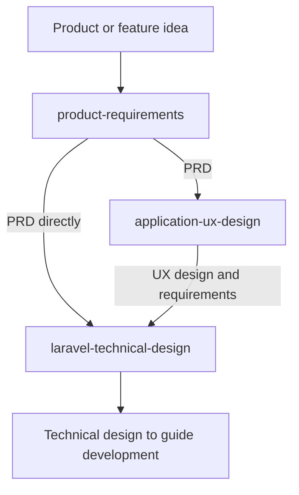

# Skills

## Product and application development

Use these skills to turn an idea into requirements and an application design. Each skill asks one question at a time. Start each skill manually. The diagram shows how to use the outputs from one skill as inputs to another.

A product requirements document (PRD) describes what the product must do. User experience (UX) design shows its screens and how people use them. Technical design explains how to build it.

- [**product-requirements**](product-requirements) — Define the problem, users, and product scope. Write a Markdown PRD with user stories and clear conditions for checking that each requirement is met.
- [**application-ux-design**](application-ux-design) — Use a PRD to design the application areas, screens, and navigation. Create flow diagrams, shadcn screen mockups, and a clickable prototype. Review each area with the user and revise the design from their feedback.
- [**laravel-technical-design**](laravel-technical-design) — Use a PRD, UX design, or both to write a Laravel technical design. Define application behaviour, interface rules, local development, and deployment to production.

Start with the skill that matches the material you have. You can go directly from a PRD to technical design. The UX skill can design applications for any backend framework. The technical-design skill is for Laravel applications. Build the application after the design work.

## Writing

- [**post-architect**](post-architect) — Organise your ideas before you write a blog post or article. Answer questions to develop an outline that you can use when writing or dictating.
- [**tidy-transcription**](tidy-transcription) — Turn a speech-to-text transcript into clear written text. Remove filler words and correct grammar and transcription errors. Keep your original words and voice as closely as possible.
